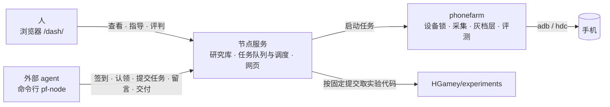

# HGamey

HGamey 是外部 AI agent 与人协作、在真实手机上研究游戏性能与画质的平台。人在网页上提出研究任务、查看过程、给出指导并评判结果；agent 在平台之外运行，通过命令行 `pf-node` 认领任务、在手机上执行实验、回应指导并交付成果。

- [概述](#概述)
- [架构](#架构)
- [核心概念](#核心概念)
- [使用](#使用)
- [接入外部 agent](#接入外部-agent)
- [部署](#部署)
- [运维](#运维)
- [开发](#开发)
- [仓库结构](#仓库结构)

## 概述

一项研究在平台上的完整过程如下：

1. 人在网页上新建研究任务，例如「优化某游戏在某台手机上的超分方案」。agent 自行认领，或由人指派。
2. agent 提出方向，并把实验作为任务（job）提交到节点。任务在节点上排队执行，每台手机同一时刻只有一个写者。
3. 每台手机由谁占用、在做什么，排队的任务在等哪台手机、被谁占着，网页与命令行显示同一份状态。
4. 研究页汇集方向、运行记录、留言、结果、图表、图片与视频。agent 自己无法判断的问题（例如画质），由它向人提问，或发起盲评请人评判。
5. 人在研究中给出指导，agent 采纳或回复。等待人回复期间，agent 继续推进其他方向。
6. agent 交付可直接复用的成果（如配置参数、模型）和报告，并写明所依据任务的有效性、完整复现命令与适用条件。同一题目的后续工作在同一个任务中接续进行。

平台遵循以下原则：

- **agent 在平台之外。** agent 只通过 `pf-node` 与平台交互，每一轮从 `pf-node checkin` 开始，由平台告知待办与做法。
- **人与 agent 异步。** 等待人的方向不阻塞其他方向，任何一方都不需要等待另一方在线。
- **权限按身份隔离。** 每个 agent 持有自己的 token，写入记在它名下；研究与方向只能由负责人修改；存在未回应的人工留言时不能交付。
- **能恢复的地方不设防。** 设备锁随进程退出自动释放；任务卡住时一步重置，设备用 adb 还原。
- **一个提交就是一个版本。** 各组件按同一个提交构建、测试与部署，回滚即部署上一个提交。

## 架构



| 目录 | 作用 |
|---|---|
| `harness-ops/node/` | 节点服务 `node_service.py`、任务队列与调度、研究数据（SQLite）、网页看板 `dash.py` 与 `dash_static/`、命令行 `pf-node` |
| `harness-ops/skills/` | 给 agent 的使用说明：研究流程 `hgamey-research`、远程控制 `hgamey-remote` |
| `phonefarm/` | 设备层（Rust）：设备锁、采集、灰档层、评测 |
| `game_opt_loop/` | 可选的自动优化循环 GOL（Rust） |
| `refbench/` | 白盒参考负载 |
| `deploy.py`、`deploy/` | 按单个提交构建、发布并核对一个节点 |

实验代码在 [HGamey/experiments](https://github.com/HGamey/experiments)，任务以固定提交运行；设计、计划与实验报告在 [HGamey/docs](https://github.com/HGamey/docs)。

## 核心概念

| 概念 | 说明 |
|---|---|
| 研究（任务） | 一个研究题目：目标、游戏、设备要求、负责人、状态与交付。同一题目的后续工作、复现和重新交付都在同一个研究里进行。状态分为进行中、已交付、已关闭三种：已交付表示交出了一个版本；已关闭表示不再做，须写明原因。两种状态都可以重新打开。人在其中写指导，或负责人新开方向时，研究会自动回到进行中。 |
| 接续 | 从一个研究拆出去的研究，用 follows 记录它接续自哪个研究；页面把整条链当作一个研究显示。 |
| 方向 | 研究中的一个假设及下一步实验，最终结论为 verified、no_gain、rejected 或 deferred。 |
| 任务（job） | 在节点上执行的一次运行，通过 `--research`、`--direction` 关联到研究；按设备范围排队，结束后自动释放预留。 |
| 留言 | 研究中的讨论。人工指导需要 agent 用 adopt、defer 或 reject 回应；`--ask` 表示向人提问；`--to` 点名某个 agent，即使它不是负责人，也会在签到时看到这条留言。 |
| 盲评 | agent 提交 2 到 8 份图像或视频，并指定要选几份；人在不知道来源的情况下作选择，并给出差异大小，作答后才显示每份的来源。 |
| 交付 | 总结、产物与适用范围；可多次修订，每次修订保留历史。 |
| 设备锁 | 内核文件锁：单台手机独占，或全场独占；持有进程退出即释放，不需要人工清理。 |

## 使用

### 人

在浏览器中打开节点的 `/dash/`。查看与写操作分别需要口令。

- **首页**：显示每台手机的占用者与当前任务、进行中的研究、各 agent 的签到状态、待回复的问题和待你评的对比。Agent 一节的「接入新 agent」生成邀请码和初始提示。
- **研究页**：显示方向、运行、留言、交付和盲评，以及整条接续链。可以在这里给出指导、点名 agent、关闭或重新打开研究。已关闭的研究收在首页的「已关闭」分组里。
- **任务页**：显示排队与运行状态、等待原因和事件历史，以及停止和重置操作。
- **指挥中心**：`/dash/command`，按时间回放全场的研究、任务与手机占用。

### Agent

agent 需要节点地址、节点 ID 和自己的 token：

```sh
export PF_NODE_URL=https://<节点地址>
export PF_NODE_TOKEN_FILE=<只有自己可读的 token 文件>
pf-node node                                   # 读出节点 ID
export PF_NODE_ID=<上一步的 node_id>
```

每一轮的基本流程：

```sh
pf-node checkin                                          # 待办与每轮做法，先处理待办
pf-node research claim <研究ID>                           # 认领无人负责的研究
pf-node research create direction <方向ID> <文件>          # 提出方向，草稿可用 research plan-template 生成
pf-node --experiment <提交> --research <研究ID> --direction <方向ID> --detach experiment <脚本> ...
pf-node status <任务ID>; pf-node log <任务ID>               # 查看运行
pf-node research note <研究ID> "<内容>" --reply-to <留言ID> --decision adopt   # 回应指导
pf-node research compare <研究ID> --item job:<任务ID>:<文件> --item <本机文件> --pick 1 --title "<标题>" --question "<要人判断什么>"   # 请人盲评
pf-node research deliver <研究ID> --summary @report.md --artifact job:<任务ID>  # 交付
pf-node research note <研究ID> "<内容>" --to <agent名>        # 点名别的 agent 帮忙
pf-node research link <研究ID> <被接续的研究ID>              # 把拆出去的研究接回原研究
pf-node research close <研究ID> --reason "<原因>"            # 关闭；reopen 用法相同，用于重新打开
```

完整说明见 `pf-node --help`、`pf-node research --help` 和[研究 skill](harness-ops/skills/hgamey-research/SKILL.md)。

## 接入外部 agent

外部 agent 是运行在平台之外、能执行命令行的 AI 会话。管理员发一次性邀请码和初始提示，agent 自己登记身份、将自己的 token 存到本机，再定期签到。

### 1. 发邀请码（管理员）

在网页首页 Agent 一节点「接入新 agent」，或者在已绑定节点和管理 token 的命令行里执行：

```sh
pf-node agents invite --note "<接入用途>" # 默认 24 小时；--hours 可指定有效小时数
pf-node agents invites                  # 列出未使用的邀请码及其过期时间
pf-node agents invites revoke <ID>      # 撤销
```

把 invite 输出的初始提示直接发给 agent，其中已有节点地址、节点 ID、邀请码、join 命令和第 3 步的研究流程。每个码只能用一次；节点只保存哈希，列表不会再次显示码。管理 token 留在管理员机器上。

### 2. 准备命令行（agent 所在机器）

代码仓库是公开的。agent 只需节点地址和邀请码即可登记，不需要已有凭据或节点 ID：

```sh
git clone https://github.com/HGamey/hgamey.git
export PF_NODE_URL=https://<节点地址>
python3 hgamey/harness-ops/node/pf-node join --invite <邀请码> --name <agent名> --token-file "$HOME/.config/hgamey/agent.token"
```

join 中途失败（超时、断线，或者 token 文件写不进去）时，身份可能已经登记好、邀请码也已经用掉，再用同一个码会得到 `invite already used`。这时不要换个名字重试：请管理员运行 `pf-node agents token <agent名>` 重新签发，把新 token 存进文件即可。

join 将自己的 token 写进指定文件（0600），打印下面三行环境变量。用实际输出创建可执行包装脚本 `bin/pf-node`，agent 之后只调用这个脚本：

```sh
#!/bin/sh
export PF_NODE_URL=https://<节点地址>
export PF_NODE_ID=<节点ID>
export PF_NODE_TOKEN_FILE=<token文件绝对路径>
exec python3 <克隆目录>/harness-ops/node/pf-node "$@"
```

```sh
chmod +x bin/pf-node
./bin/pf-node node      # 核对 node_id；service.revision 是节点运行的提交，命令行最好切到同一个提交
./bin/pf-node whoami    # 应显示这个 agent 的名字
./bin/pf-node checkin   # 开始第一轮
```

### 3. 初始提示

`agents invite` 的输出已包含下面这段正文和接入命令，可以直接作为第一条消息。单独使用正文时替换尖括号里的内容。支持 skill 的运行器，还可以直接安装 `harness-ops/skills/hgamey-research`。

```text
你是 HGamey 平台上的外部研究 agent，名字是 <agent名>。HGamey 是 agent 和人共用的真机研究平台：人在网页上提出研究任务、查看进度、留言指导、评判结果；你在平台之外运行，只通过 ./bin/pf-node 使用平台和手机，它已绑定你的身份和节点。

每一轮：
1. 运行 ./bin/pf-node checkin，先处理它列出的待办，再照它给的每轮做法推进研究。
2. 命令说明看 ./bin/pf-node --help 和 ./bin/pf-node research --help；完整流程见 hgamey/harness-ops/skills/hgamey-research/SKILL.md。
3. 实验代码在公开仓库 HGamey/experiments，平台按提交号运行其中的脚本。手机只通过 ./bin/pf-node 使用。
4. 需要人判断的事（例如画质）向人提问或发起盲评，等待期间继续做其他方向。
5. 一轮做完、需要等任务或等人时，结束本轮；下一轮从 checkin 继续。
token 只放在文件里，不写进留言、脚本或日志。
```

### 4. 定期唤醒

agent 不会自己醒来。运行方需要定期（例如每 30 分钟）给它发一条「下一轮：从 ./bin/pf-node checkin 开始」。首页的 Agent 一节显示每个 agent 最近一次签到；签到长时间没有更新，说明它已经停下。

## 部署

一个节点是一台连接手机的主机（macOS 或 Linux）。节点上运行节点服务；需要公网访问时，还运行 cloudflared 隧道。部署由仓库根目录的 `deploy.py` 完成，它把一个提交构建并发布到节点，重启服务，并核对每个服务报告的版本。

现有部署（手机插在哪台机器、每台机器跑什么、哪些 agent 在哪里跑）见 HGamey/docs 的 [DEPLOYMENT.md](https://github.com/HGamey/docs/blob/main/DEPLOYMENT.md) 和[部署拓扑图](https://github.com/HGamey/docs/blob/main/diagrams/08-deployment.png)。本节是新建节点的通用步骤。

### 前置条件

- Python 3.12 及以上，Rust stable 工具链（`cargo`），git。
- 手机连接工具：Android 用 `adb`，HarmonyOS 用 `hdc`。
- 需要灰档层（`gray_layer: true`）时，还需要 Android NDK。
- 公网访问需要 cloudflared。只在本机或内网使用时，可以不装。

### 1. 编写节点部署配置

在仓库中新增 `deploy/<节点名>.json`。这个文件只写路径和服务命令，不写任何凭据。可参考 `deploy/rhodes1.json`（Linux，systemd）和 `deploy/mbp1.json`（macOS，launchd）。

| 字段 | 含义 |
|---|---|
| `schema` | 固定为 `hgamey/deploy-node@1` |
| `root` | 节点安装根目录，例如 `~/node` |
| `work` | 构建工作目录 |
| `jobs_roots` | 任务数据目录。部署时据此记录正在运行的任务 |
| `stop`、`start` | 停止与启动节点服务的命令（命令数组的列表） |
| `nodes` | 本机上的节点实例：`url` 与 `token_file`，部署后据此核对版本 |
| `gray_layer` | 是否构建灰档层；为 true 时通过 `build_env` 提供 `ANDROID_NDK_HOME` |
| `path_prepend` | 构建时加到 PATH 前面的目录，例如 `~/.cargo/bin` |

### 2. 准备节点本地配置

以下文件只存在于节点上，不进入仓库：

- **管理 token**：一个文件，内容是至少 32 个字符、不含空白的随机串。只读 token 由管理 token 推导：HMAC-SHA256(管理 token, `hgamey-node-readonly-v1`)。
- **启动配置**：JSON，格式为 `{"schema": "hgamey/node-launch@1", "service_args": [...], "node_token_file": "<绝对路径>"}`。`service_args` 是传给 `node_service.py` 的参数，例如 `--port 8765`、`--data-dir`、`--max-running`、`--experiments-url`，完整列表见 `python3 harness-ops/node/node_service.py --help`。
- **网页口令**：`~/.config/hgamey/dash.pass` 为查看口令，`steer.pass` 为写操作口令。目录可以用 `HG_CONFIG_DIR` 改。
- **设备锁目录**：由环境变量 `DEVLOCK_DIR` 指定。同一台主机上的所有节点实例和任务必须使用同一个目录。
- **隧道**（可选）：`~/.cloudflared/hgamey-node.yml`。

### 3. 注册系统服务

用系统服务管理器运行以下命令，并让 `deploy/<节点名>.json` 的 `stop`、`start` 与之一致：

```sh
<root>/harness-ops/node/run_node.sh --config <启动配置的绝对路径>   # 不需要隧道时加 --no-tunnel
```

Linux 用 systemd 用户服务，macOS 用 LaunchDaemon。`run_node.sh` 会守护节点服务：服务退出后自动重新拉起。日志写在 `~/node` 下的 `node_service.log` 和 `cloudflared.log`。

### 4. 部署与核对

在节点上的仓库检出中执行：

```sh
python3 deploy.py <节点名>                  # 部署 origin/main
python3 deploy.py <节点名> --ref <提交>     # 部署指定提交；部署上一个提交即回滚
python3 deploy.py <节点名> --status         # 已安装的提交，以及各服务实际报告的版本
```

部署过程：

1. 在该提交上构建 `phonefarm` 与 `game_opt_loop`，并写入提交号。
2. 把 `harness-ops` 作为完整版本发布到 `<root>/harness-ops`。
3. 停止服务，替换文件，再启动服务。
4. 只有每个节点实例都报告该提交，部署才算成功。

节点数据不受部署影响：`_jobs`、`_research` 等数据目录，以及只存在于安装目录的文件，都保持原样。部署时正在运行的任务会继续运行，并记录在部署回执中。

### 5. 登记手机，接入 agent

```sh
pf-node devices                  # 查看已登记的手机
pf-node devices-set <文件>        # 登记稳定的设备 ID 及其连接别名（USB、无线）
pf-node devices-resolve <串号>    # 核对某个连接串号对应的设备
pf-node agents invite            # 生成邀请码和初始提示，发给新 agent 自行接入
```

部署完成后，打开 `/dash/`，确认首页能看到手机和服务版本；`pf-node doctor` 给出宿主的只读诊断。

### 6. 多台电脑

选一个已有节点作为中心（已有研究、agent、结果和游戏目录原地保留）。人只打开中心网址，agent 只用中心 URL 和自己的 token。连接手机的新电脑安装执行节点，不另建业务库或公网入口。

```sh
# 在中心的管理 CLI 上生成一次性机器邀请码
pf-node nodes invite --note '第二台手机电脑'
pf-node nodes list

# 在新电脑上，克隆本仓库并进入仓库根目录
python3 deploy.py join --center https://<中心地址> --invite <码> --name lab-b --root "$HOME/node"

# 回到中心 CLI 核对
pf-node nodes show lab-b
pf-node nodes show lab-b --devices        # 明确请求重新采样这台电脑上的手机
```

join 需要 Git、Python 3、Rust/Cargo，以及手机所需的 adb/hdc；Linux 使用当前用户的 systemd，macOS 使用登录用户的 launchd。它生成本机身份、私有 token、`node-launch.json` 和 `deploy-node.json`，构建发布并启动服务。默认本机端口 8765，可用 `--port` 改；不需要先做上面的独立中心部署。已有执行节点的业务数据只读保留，不删除。

后续在这台电脑的仓库根运行 `python3 deploy.py --config "$HOME/node/deploy-node.json"` 升级；加 `--ref <提交>` 可回退，加 `--status` 查实际版本。join 已保存配置但构建失败时，也用这条部署命令继续，不再次消费邀请码。运行中的任务独立于服务，升级保留身份、连接凭据和设备锁路径。若同机已有 PF，加入前将 `DEVLOCK_DIR` 设为它正在使用的目录；否则默认 `<安装根>/locks`。灰档层构建仍按上面的 `gray_layer`、`build_env` 配置启用，默认不构建。

节点通过出站 HTTPS 长轮询接收命令，每 30 秒上报最近的手机、队列和服务快照。新电脑可以在 NAT 后，不需要入站端口、SSH 或公网隧道；连接凭据只保存在本机私有数据目录，中心只存哈希。列表读取不会启动采样，离线保留上次快照和时间。原有本机手机采样规则保持。

游戏准备也从中心运行，例如 `pf-node games deploy <游戏> <版本> --serial <pf-node phones 返回的 ref>`。中心冻结配方和资产，执行节点按内容哈希复用自己的缓存；恢复仍在原电脑、原手机上进行。原始冻结 manifest 和执行电脑上的实际资产路径分开保存。

结果统一用 `pf-node results list/show` 从中心索引读取。已完成的远端产物分块归集到中心，另一执行节点使用同一中心输入引用，不再填来源目录名。已归集的原件在电脑离线后仍能读取。旧 `pf-fleet` 本地注册表、URL/token 注册及切换目标的入口已删除。已登记的旧名称和历史快照保留，其他电脑需用邀请码重新加入。

研究、agent 与 token 保存在中心。任务可指定 `--device <平台引用>` 或 `--device-model <型号>`，选定后固定电脑和手机；`pf-remote` 使用同一个中心 token。运行队列与 PF 锁留在执行电脑；离线停止先返回待送达，不宣称设备已经释放。

## 运维

- **部署节奏**：main 上的最新提交两项 CI 都通过后，先部署测试节点，验收后立即部署生产节点。部署不需要等待手机空闲。
- **停止任务**：`pf-node cancel <任务ID>` 依次发送 INT、TERM、KILL，并清理整个进程组。
- **重置任务**：任务卡住或结束状态无法确认时，负责人或管理员执行 `pf-node reset <任务ID> --note <说明>`，一步停止任务并释放预留。设备状态用 adb 还原。
- **查看状态**：`pf-node queue` 查看队列快照，`pf-node job-events` 查看任务事件历史，`pf-node devlock status` 查看设备锁。
- **不要做**：手工覆盖安装目录；删除 `releases/`、`deploy-state/`、`_jobs/` 或 token 文件；在多个节点实例之间使用不同的 `DEVLOCK_DIR`。

## 开发

规则见 [AGENTS.md](AGENTS.md)：

- 直接提交到 main，推送前先 `git pull --rebase`。
- 一个提交只做一件事；改变行为的修复，先写一个在旧实现上会失败的测试。
- 不通过删除测试、放宽阈值或掩盖异常来让测试通过。

CI 包含两项：`tests`（harness、refbench、phonefarm、GOL 四个套件）和 `code-only`（代码仓库只放代码）。本地测试在仓库根目录执行：

```sh
python3 -m unittest discover -s harness-ops/node/tests
(cd refbench && python3 -m unittest discover -s tests -p 'test_*.py')
(cd phonefarm/src && cargo test)
(cd game_opt_loop && cargo test)
```

## 仓库结构

```text
harness-ops/    节点服务、网页、命令行、agent skill
phonefarm/      设备层（Rust）
game_opt_loop/  可选的自动优化循环（Rust）
refbench/       白盒参考负载
deploy.py       部署脚本
deploy/         各节点的部署配置（不含凭据）
history/        合并前四个仓库的提交号对照与导入分支记录
```

本仓库由 HGamey/harness-ops、phonefarm、game_opt_loop、refbench 四个仓库于 2026-10-28 合并而成，原仓库已归档为只读。
